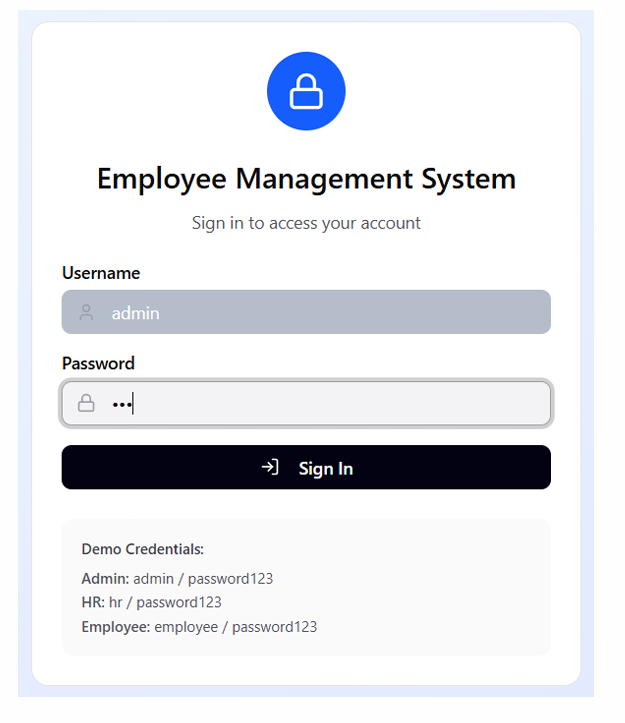
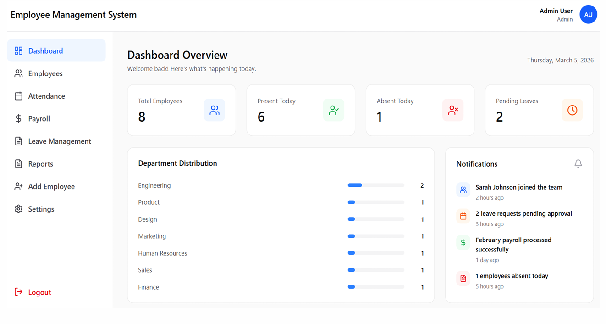
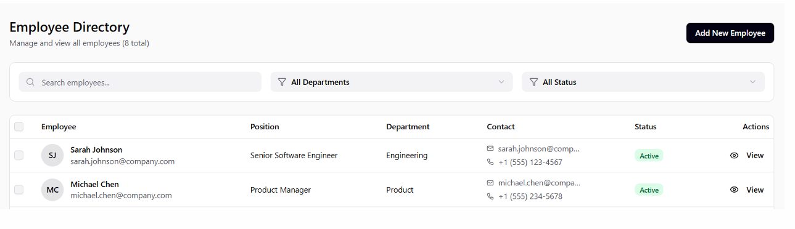
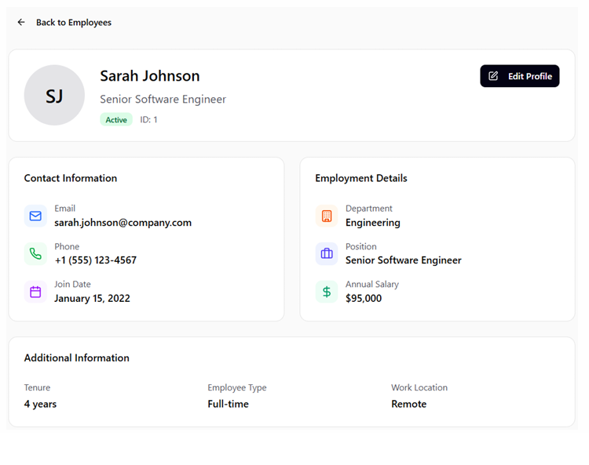
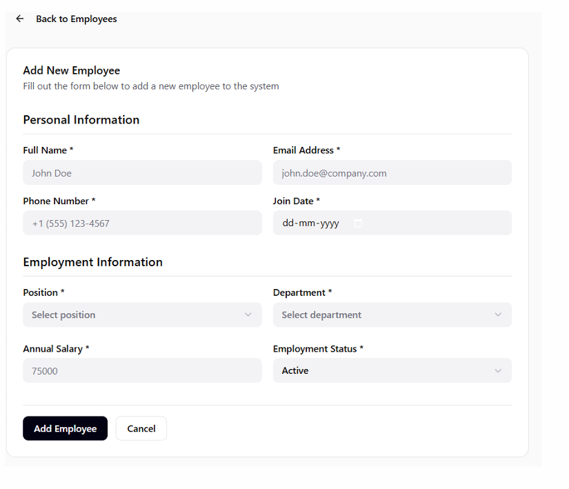
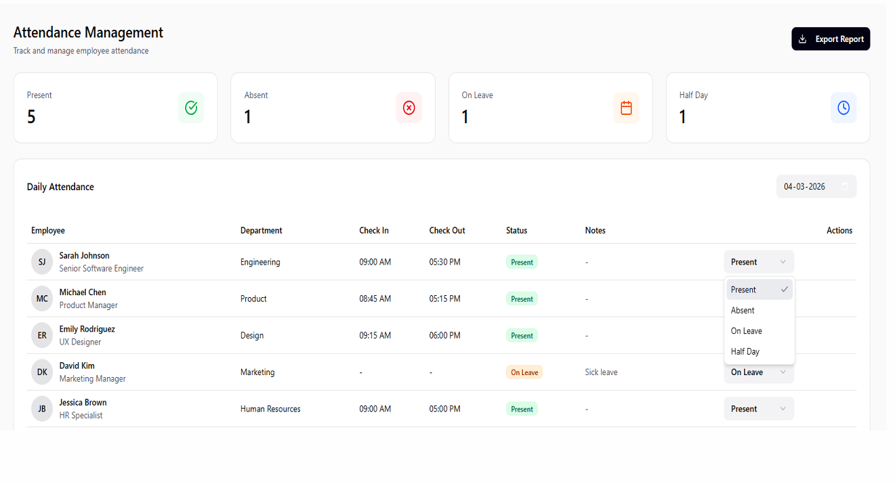
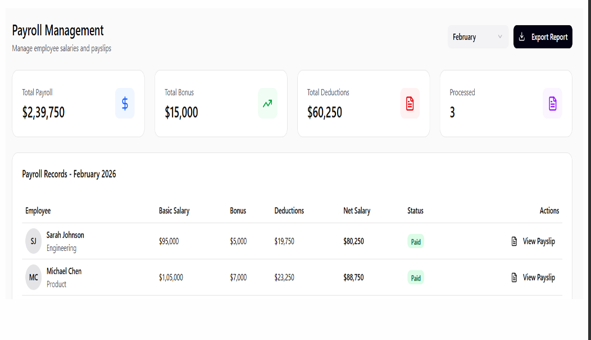
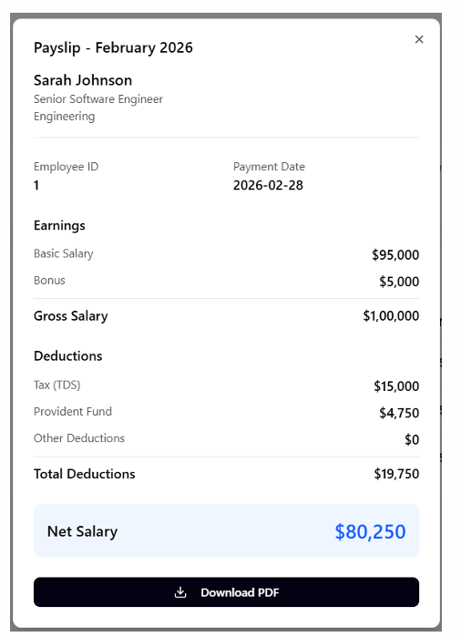
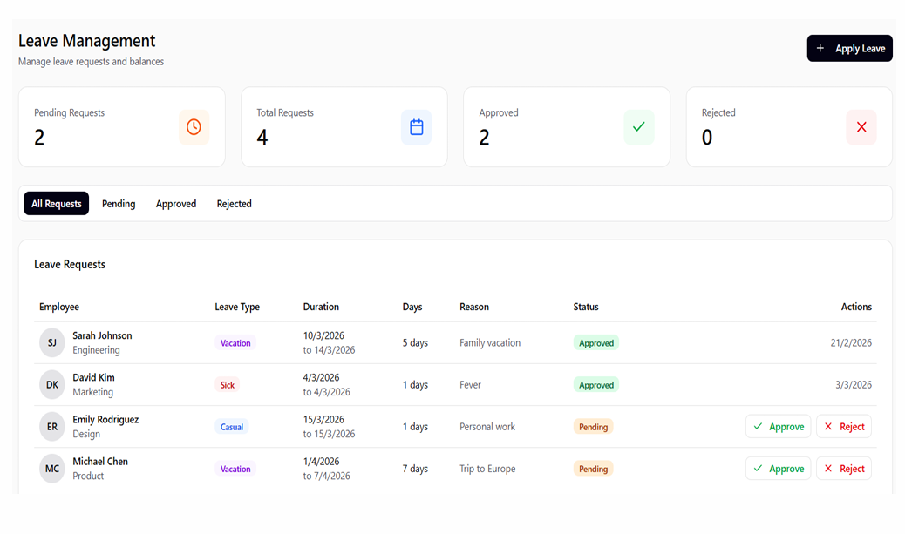
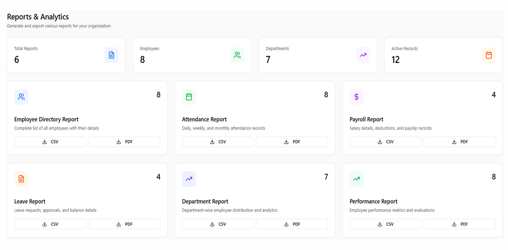

# Employee Management System (Frontend & UI/UX Showcase)

A comprehensive, fully responsive web application interface designed to streamline internal human resource operations, track daily attendance, manage corporate payrolls, and handle employee leave pipelines seamlessly.

---

## 🚀 Project Overview

Managing workforce data manually introduces operational bottlenecks. This project solves that challenge by serving as a unified administrative hub. Built with modern frontend design patterns, the platform delivers a clean, intuitive dashboard environment allowing core roles—Admin, HR, and Employees—to interact with professional lifecycles, view individual payslips, evaluate monthly payouts, and track team analytics in real-time.

### Key Features
*   *Role-Based User Interface:* Secure landing panels containing dedicated interactive simulation layouts for Admin, HR, and staff accounts.
*   *Dynamic Command Center:* High-level analytics metrics dashboard highlighting active employee counts, real-time presence trackers, pending workflow states, and system notifications.
*   *Granular Employee Directory:* Searchable and filterable records directory built for full lifecycle management—encompassing rapid profile creation, onboarding data tracking, and salary profile details.
*   *Attendance Tracking View:* Operational registers monitoring check-in/out times, tracking absences, and displaying active situational notes.
*   *Automated Payroll Calculations:* Front-end logic computes gross earnings alongside itemized calculations (TDS taxes and Provident Fund reductions) to render professional, download-ready payslip layouts.
*   *Leave Pipeline UI:* Centralized tracking logs that display employee requests while giving administrators interactive tools for single-click approval or rejection.
*   *Analytics & Business Intelligence Dashboard:* A modular data center designed to show attendance, payroll, and performance metrics with functional options to export datasets directly into CSV or PDF formats.

---

## 🛠️ Technology Stack

*   *Domain Focus:* Frontend Web Development / UI-UX Engineering
*   *Design & Wireframing:* Figma (High-Fidelity Wireframing & Interactive Prototyping)
*   *Core Technologies:* HTML5, CSS3, JavaScript (ES6+)
*   *Styling & UI Component Libraries:* Layout builds compiled via Tailwind CSS & Bootstrap 5
*   *Developer Environment:* Visual Studio Code (VS Code), Git workflow versioning, and GitHub

---

## 📸 Interface Showcase

> Note: Below are the visual walkthroughs of the finalized software user interface.

### 1. Secure Authentication Gateway
A unified landing login panel offering user entry simulation alongside pre-configured roles for evaluation.

### 2. Administrative Central Dashboard
An analytics dashboard giving operational visibility over company distribution, department counts, and system alerts.

### 3. Employee Directory & Profile Inserts
Robust search directories and comprehensive user profile sheets displaying corporate financial information and personal metrics.

### 4. Interactive Attendance Ledger
Live check-in layout models tracking structural presence times, active sick leaves, and shift completions.

### 5. Payroll Management & Itemized Payslips
Payroll views displaying monthly earnings, applying appropriate tax adjustments, and generating professional PDF vouchers.

### 6. Leave Management Pipelines
A real-time tracking interface detailing employee vacation durations, reasons, and direct action triggers.

### 7. Reports & Export Engine UI
A modular reporting center built to present attendance, payroll, and performance metrics in clean, professional layouts optimized for CSV and PDF exporting.

---

## 🧠 UI/UX & Architecture Decisions

1.  *Component Accessibility & Responsiveness:* Built completely fluid layouts utilizing the best of Bootstrap 5 and Tailwind CSS, isolating structural UI components for easy scalability and maintenance.
2.  *Data Presentation:* Prioritized data hierarchy using explicit visual grids to handle complex tables—like payroll ledgers and attendance logs—without cluttering the workspace.
3.  *User-Centered Styling:* Implemented structured card segments, accessible typography, and distinctive visual anchors using clear UI-UX prototyping methodologies in Figma to lower administrative fatigue.
